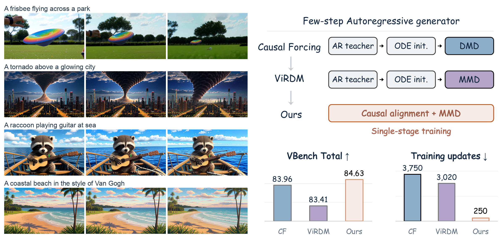
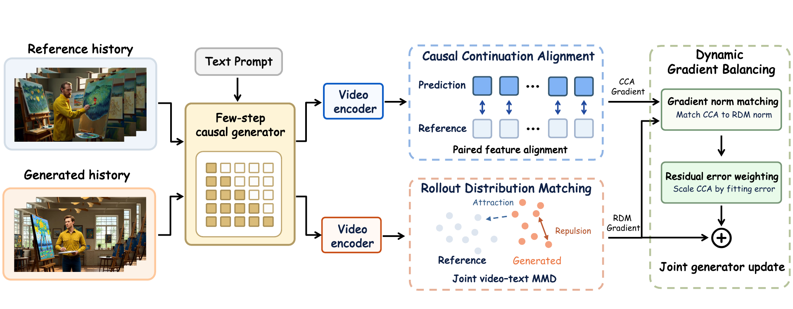

<div align="center">

# Direct Forcing

### Single-Stage Training with Representation-Space Supervision for Few-Step Autoregressive Video Generation

Haojun Xu<sup>1,2</sup> · Jie Huang<sup>2,*,‡</sup> · Chuyang Zhao<sup>2,‡</sup> · Xin Lu<sup>2</sup> · Mingchen Zhong<sup>2</sup><br>
Zihao Fan<sup>2</sup> · Haoyang Huang<sup>2</sup> · Linjiang Huang<sup>1,†</sup> · Si Liu<sup>1</sup>

<sup>1</sup> Beihang University · <sup>2</sup> JD Future Academy

<sup>†</sup> Corresponding author · <sup>‡</sup> Project leader · <sup>*</sup> Co-first author

[](https://arxiv.org/abs/2610.30861)
[](https://xuhaojun1.github.io/Direct-Forcing/)

[Project Page](https://xuhaojun1.github.io/Direct-Forcing/) · [Paper](https://arxiv.org/abs/2610.30861) · [Quick Start](#quick-start) · [Training](#training) · [Evaluation](#evaluation)

</div>

Direct Forcing learns few-step autoregressive video generation in a **single
training stage**, starting from pretrained bidirectional Wan weights.

[](assets/figures/showcase.jpg)

## Overview

[](assets/figures/pipeline.png)

**Causal continuation alignment (CCA)** fits causal predictions to reference
clips, while **rollout distribution matching (RDM)** matches self-generated
videos to the reference distribution. **Gradient norm matching (GNM)** calibrates
their gradient scales, and **residual error weighting (REW)** adjusts CCA's
contribution using its remaining fitting error.

This repository provides the complete short-video, **4-step chunk-wise** workflow:
data preparation, reference construction, training, inference, and VBench evaluation.

## Quick Start

### Installation

Use Linux, Python 3.11, and a CUDA-13-compatible NVIDIA driver. Run from the
repository root:

```bash
python -m pip install torch==2.12.1 torchvision==0.27.1 \
  --index-url https://download.pytorch.org/whl/cu130
python -m pip install -r requirements.txt
python -m pip install flash-attn==2.8.3 --no-build-isolation
python -m pip install -e . --no-deps
```

### Model assets

Download the pretrained assets:

```bash
python scripts/download_models.py
```

This downloads Wan 1.3B, VideoMAE v2, DiT 14B transformer weights, and TAEW.
For inference only, add `--models wan`.
See [expected model files](docs/installation.md#expected-model-files).

### Inference with your checkpoint

**Trained Direct-Forcing checkpoints are not distributed in this release.**
After [training](#training), use the resulting `model.pt` and replace `RUN` with
your run directory:

```bash
GPUS=1 bash scripts/infer_chunkwise_4step.sh \
  --checkpoint outputs/chunkwise_4step/RUN/checkpoint_model_000250/model.pt \
  --prompts assets/prompts/demo.txt \
  --output outputs/demo
```

This generates 81 frames at 16 fps, with four denoising steps per
3-latent-frame chunk. Use `GPUS=8` to distribute prompts across eight GPUs.

## Training

Training uses **VideoMAE v2 L24 for CCA** and **VideoMAE v2 L16 + DiT L9 for RDM**,
with global CCA batch 32, RDM batch 128, **250 updates**, and **GNM + REW**.

### 1. Prepare data

Download the [Causal-Forcing data](https://huggingface.co/zhuhz22/Causal-Forcing-data)
and prepare the training caches:

```bash
hf download zhuhz22/Causal-Forcing-data --local-dir data/Causal-Forcing
python scripts/prepare_data.py
```

### 2. Build RDM references

```bash
bash scripts/prepare_references.sh
```

### 3. Train on 8 GPUs

```bash
bash scripts/train_chunkwise_4step.sh
```

For asset paths and W&B logging, see [configuration](docs/configuration.md).

## Evaluation

Set up [VBench in a separate environment](docs/evaluation.md#setup), then run
generation and scoring from the Direct-Forcing environment:

```bash
bash scripts/eval_vbench.sh \
  --checkpoint outputs/chunkwise_4step/RUN/checkpoint_model_000250/model.pt \
  --output outputs/vbench/main --gpus 8 \
  --vbench-python /path/to/vbench/python
```

Evaluation uses **944 unique prompts**, five samples per prompt, and all
16 VBench dimensions. Results are written to `outputs/vbench/main/scores.json`.
See the [evaluation guide](docs/evaluation.md) for prompt settings, score units,
and generation/scoring options.

## Citation

```bibtex
@misc{xu2026directforcing,
  title={Direct Forcing: Single-Stage Training with Representation-Space Supervision for Few-Step Autoregressive Video Generation},
  author={Haojun Xu and Jie Huang and Chuyang Zhao and Xin Lu and Mingchen Zhong and Zihao Fan and Haoyang Huang and Linjiang Huang and Si Liu},
  year={2026},
  eprint={2610.30861},
  archivePrefix={arXiv},
  url={https://arxiv.org/abs/2610.30861}
}
```
